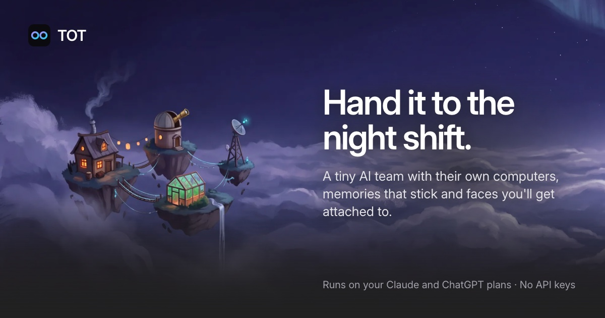

# TOT



TOT is your own always-on AI agents, in the spirit of ChatGPT Dots and Grok Bot, running on **your own subscriptions**: ChatGPT (through Codex) and Claude (through Claude Code). Every agent has a **mascot**, a **personality**, **its own cloud computer**, shared **long-term memory** about you, and **plugins**. It runs on your computer, as a web app or a Mac app, and your phone connects to it.

## Features

- **Agents.** Create as many as you like (Tot is the default). Each one has an animated mascot that shows what it's doing (thinking, working on its computer, talking), a personality, a default model, and a computer that persists across all of its chats.
- **Two brains, one app.** Claude Opus 5.5 / Sonnet 5.5 through your Claude subscription, GPT‑6.x through your ChatGPT plan. No API keys needed for local use.
- **TOT Auto.** Quick asks go to Sonnet 5.5 (fast); coding, debugging, research and long requests go to Opus 5.5; "Think harder" forces Opus at extra-high effort. When a plan hits its usage limit, Auto moves to the other provider until it resets.
- **A computer per agent.** A [boat.dev](https://boat.dev) cloud VM (Ubuntu, Docker, Node, Python, Chrome, 60 fps desktop) created on first use and stopped when idle. Agents run shell commands, edit files, share web servers as public links, and **use the desktop** (screenshot, click, type) for sites that need a real browser, while you watch live. Without a Boat key, agents get a sandboxed local folder instead (no desktop).
- **Tasks and projects.** A chat can turn into a background task with its own git branch and worktree, steered, paused and queued from mission control, checked by tests and a cross-provider review, and landed as a merge or a draft PR. Projects group an agent's chats, repos and tickets, with a Lead chat that runs the project.
- **Routines.** Agents run recurring tasks on their own ("every weekday at 9, brief me on AI news"): ask in chat and the agent schedules it, or set one up in the agent's settings. Each run starts a new chat.
- **Attachments.** Drop in images (the model sees them), text, code and CSV files (read inline), or anything else (copied to the agent's computer under `~/uploads`).
- **Memory.** Agents save durable facts about you across chats, kept as git repos of markdown that you can browse, edit and sync between your computers.
- **Plugins.** Any MCP server. ChatGPT turns can also use the apps connected to your ChatGPT account; Claude turns can use your claude.ai connectors.
- **Everywhere you are.** A Mac app that lives in the menu bar, an iPhone app, sign-in from your phone over Tailscale or your Wi‑Fi, and paired computers that show each other's agents.
- **Light and dark.** Follows your device by default; switch in Settings → General or with the sun/moon button in the sidebar.

## Quick start

Requirements: Node ≥ 22.13 (24 recommended, see `.nvmrc`), and at least one provider logged in:

| Provider | Log in once in a terminal | Check |
|---|---|---|
| Claude (Pro/Max) | `claude` → `/login` | `claude` starts without asking to log in |
| ChatGPT (Plus/Pro) | `codex login` (or the **Connect ChatGPT** button in Settings) | `codex login status` |

```bash
git clone https://github.com/dhruvalgolakiya/tot.git && cd tot
npm install
npm run dev          # API on :8787, web app on :5173
open http://localhost:5173
```

**Cloud computers (recommended):** create a key at [boat.dev/dashboard](https://boat.dev/dashboard?tab=api-keys) ($20/month minimum, billed per second while a VM runs) and either paste it in **Settings → Computer** or put it in `.env` at the repository root:

```bash
cp .env.example .env    # then set BOAT_API_KEY=boat_...
```

Restart `npm run dev` after editing `.env`. With a key present, new agent computers are Boat VMs; without one, each agent gets a sandboxed local folder (macOS Seatbelt: writes only inside its workspace, no access to your files).

Production-style run: `npm run build && npm start` (the API server serves the built web app on :8787).

Data lives in `~/.tot` (override with `TOT_DATA_DIR`). Every setting can go in `.env`; see `.env.example`: `BOAT_API_KEY`, `ANTHROPIC_API_KEY` (only for Claude API-key mode), `TOT_PORT` (8787), `TOT_WEB_PORT` (5173, the dev web server), `TOT_CLAUDE_CONFIG_DIR`, `TOT_CODEX_PATH`.

## Mac app

TOT also runs as **TOT.app** (Apple silicon). It starts the TOT server itself, with the Node built into the app, and opens it in its own window, signed in like any browser on this computer. Close the window and TOT keeps running in the menu bar, so your phone and paired devices keep working; **Quit TOT** in the menu bar (or Cmd+Q) stops it and everything it started. If a TOT is already running on the port (say `npm run dev`), the app opens that one instead of starting a second. It uses the same port (8787) and data (`~/.tot`) as `npm start`, and you still log in to Claude and Codex once in a terminal.

```bash
npm run app:build    # apps/desktop/release/TOT-<version>-arm64.dmg and .zip (and release/mac-arm64/TOT.app)
npm run app:dev      # from this checkout: opens a running dev TOT, or starts the bundled server (run npm run build once first)
```

`npm run app:build` signs ad hoc, so that build runs on the Mac that built it. The menu bar menu has **Open at login**, so TOT is always reachable, and **Show log** (`~/Library/Logs/TOT/server.log`). Apps opened from Finder don't see your shell's PATH, so TOT reads it from your login shell and adds `node`, `npm` and `npx` of its own after yours. The installed app updates itself from this repository's GitHub releases.

For maintainers: `npm run app:release` signs with the Developer ID and has Apple notarize the app and the .dmg, so a downloaded `.dmg` opens on any Mac with no warning (it needs the signing files in `~/.private_keys`, see `apps/desktop/release.sh`), and `npm run app:publish` puts that build on GitHub releases. Details in [08 · Mac app](docs/roadmap/08-mac-app.md).

## Mobile app

`apps/mobile/` is TOT's iPhone app (Expo, React Native; not on TestFlight yet): every agent on this TOT and its paired devices with their mascots, their chats, live replies, photos and approvals, tasks (mission control, steer, pause, land, plan and changes) and projects, the model picker, agent settings, Settings (models and accounts, tasks, memory, devices), notifications while it's open or just closed (with a catch-up when it comes back), a read-only Knowledge viewer, several saved TOTs, and the last lists under a Reconnecting banner while a TOT can't be reached. It's a client of your TOT, not a copy: nothing is synced and no TOT runs on the phone (it keeps only a cache of what it last showed). It signs in like a phone browser, with the QR code from **Settings → Devices → Add a phone** (or the address and password), and shows up in the sign-in list there. Details in [14 · Mobile app](docs/roadmap/14-mobile.md).

The phone app has its own `package.json` and lockfile and isn't one of the npm workspaces (Expo, Metro and its React Native versions stay out of the rest of the repo's dependency tree), so install it on its own:

```bash
cd apps/mobile && npm install    # also applies its patches (patch-package)
npx expo start --ios             # opens it in the iOS Simulator with Expo Go (Xcode installed)
npx tsc --noEmit                 # typecheck; the phone app isn't part of the root build or tests
```

`apps/mobile/eas.json` has the build profiles; the TestFlight steps (Apple account, bundle id, signing, `eas build` / `eas submit`) are in [14 · Mobile app](docs/roadmap/14-mobile.md#testflight-what-the-user-does). `npx tsx apps/mobile/scripts/icons.mts` redraws the icon and splash from TOT's rings.

On this Mac's simulator, connect to `127.0.0.1:8787` (no sign-in needed: this computer never signs in). To try the real sign-in, turn on remote access and connect to the address Settings → Devices shows. On a real iPhone, scan the QR code `npx expo start` prints with the Expo Go app.

## Use TOT from your phone

TOT only serves this computer until you turn on remote access, and this computer never asks you to sign in.

1. Open **Settings → Devices → Set up**.
2. Choose a password. Other devices sign in with it; you can reset it from this computer if you forget it.
3. Pick how other devices reach this one: **Anywhere, with Tailscale** (recommended: install [Tailscale](https://tailscale.com) on this computer and your phone, signed in to the same account) or **Only on this Wi‑Fi**. If macOS asks whether to accept incoming connections, choose Allow.
4. Scan the QR code with your phone's camera. It opens TOT signed in, no password needed.
5. To keep TOT as an app, choose **Add to Home Screen** (Safari's Share menu, or Chrome's ⋮ menu). It opens full screen with the TOT icon.

**Settings → Devices** shows the address, a switch to turn remote access off, and every phone and browser signed in. Sign any one out there and it's out at once; changing the password signs out all of them.

How it's kept safe:

- Other devices need a session (from the password or a phone's one-time code), and wrong guesses are rate-limited.
- Cross-site requests are blocked, and the agents' tool endpoint answers only this computer.
- TOT listens only on the addresses you chose (the Tailscale or home-network address, IPv4), never on all of them, and stops the moment you turn it off. In development, the Vite dev server stays on this computer; other devices get the app through TOT.
- Voice input needs HTTPS, so the mic button hides over plain `http://`.

**From anywhere without Tailscale:** run `npm run build && npm start` and expose port 8787 over HTTPS with a tunnel, e.g. `cloudflared tunnel --url http://localhost:8787`, then set `TOT_PUBLIC_URL` to the tunnel's address. Visitors through a tunnel always sign in.

**Older setups:** `TOT_ACCESS_TOKEN`, `TOT_LAN=1` and `TOT_HOST=tailscale` in `.env` still work. The token is accepted as a password and as `Authorization: Bearer <token>` for scripts, and the other two fix the remote-access setting (the Devices page says so). Remove them to manage everything in the app.

## Install TOT on another Mac, and pair them

Each computer runs its own TOT, with its own agents, chats and logins. Pair two once, and each shows the other's agents: talk to the MacBook's agents from the Mac mini and the other way round, live on both. Nothing is copied: an agent's chats, files and logins stay on the computer it lives on. ([07 · Devices](docs/roadmap/07-devices.md) has the details.)

1. Install Node and log in to Claude and/or Codex on that Mac, as in [Quick start](#quick-start).
2. `git clone` this repo there, then `npm install`.
3. `npm run dev` there. Don't copy this Mac's `.env`: tokens and keys belong to one computer.
4. Turn on remote access on both computers (**Settings → Devices → Set up**: a password each, then Tailscale).
5. On one, open **Settings → Devices → Pair a device** and copy the link. On the other, open the same dialog and paste it. One paste pairs them both ways.

[Tailscale](https://tailscale.com) on both is the way to go: it works from anywhere, not just your Wi-Fi, and it's encrypted. Plain Wi-Fi works too, at home only. If a computer has a name or tunnel of its own, set `TOT_PUBLIC_URL` to it.

Each computer keeps its own logins, GitHub, Slack, mail and apps. If both run the same Slack bot or mailbox, Settings → Devices warns you, since both would answer.

## How it works

```
Browser, Mac app or phone (React + Vite; Electron; Expo)
   │  REST + Server-Sent Events (/api/*)
   ▼
TOT server (Hono on Node)  ── SQLite (~/.tot/tot.db: chats, memory index, plugins, settings)
   │  picks a model (TOT Auto router), builds the system prompt (persona + memory)
   ├─► Claude provider ── Claude Agent SDK ──► Claude Code (your Claude login)
   └─► ChatGPT provider ── codex app-server ──► Codex (your ChatGPT login)
            │                                   both locked down: no local shell/file tools
            ▼
   TOT MCP server (/mcp/<chat>)  ── computer_* tools ──► the agent's Boat VM (or sandboxed local folder)
                                 ├─ desktop tools    ──► screenshot / click / type on the VM's desktop
                                 ├─ memory_* tools   ──► memory repos (git + markdown)
                                 └─ routine_* tools  ──► scheduler (starts new chats when due)
```

- The agent harnesses run on your machine, but their local shell/file tools are disabled. Everything the agent *does* goes through TOT's MCP tools, which act on that chat's computer.
- Each agent's computer is created on its first tool call, stopped after `idleStopMinutes` (default 10) and resumed on the next call; files and installed packages persist, running servers don't.
- Each chat keeps its provider session (Claude session / Codex thread), so follow-ups resume with full context. Switching providers mid-chat carries the transcript over.
- Replies stream token by token. Runs are decoupled from the HTTP request: reload the page mid-reply and it reattaches.

## Repository layout

An npm workspaces monorepo:

```
apps/
  server/            the TOT server (@tot/server): Hono on Node, SQLite, agents, providers, MCP tools
    index.ts, routes.ts   HTTP API (+ local-only Host/Origin guard)
    agent/                orchestrator, Auto router, prompts, run registry
    agent/providers/      claude.ts (Agent SDK), chatgpt.ts (codex app-server)
    mcp/server.ts         built-in MCP server: computer, desktop and memory tools
    computer/             Boat and local backends, lifecycle manager (lazy start, idle stop), screenshots
    data/                 SQLite repositories
  web/               the web app (@tot/web): React, Vite, Tailwind
  desktop/           the Mac app (tot): Electron main process, bundled server, menu bar, packaging, releases
  mobile/            the iPhone app (Expo): its own package.json and lockfile, outside the workspaces
  site/              the landing page and docs (@tot/site): a static site, deployed on Vercel
packages/
  shared/            the API contract every app shares (@tot/shared): types, and the agents' islands
docs/
  DESIGN.md          the design standard
  roadmap/           how each module was planned and built
scripts/
  e2e.ts             an end-to-end check against a running TOT
```

`npm run build` writes the web app to `dist/` at the repository root. The server serves `dist/` from its working directory (the repository root for `npm start`, the app's own folder in the Mac app) and reads `.env` from there too, so the root scripts run it from the root.

## Development

| Command | What it does |
|---|---|
| `npm run dev` | the API (`dev:server`, restarts on changes) on :8787 and the web app (`dev:web`, Vite) on :5173 |
| `npm run build` | builds the web app into `dist/` |
| `npm start` | runs the server in production mode, serving `dist/` on :8787 |
| `npm test` | every test suite (server, then Mac app), each with its own temporary data folder |
| `npm run typecheck` | TypeScript for every workspace and `scripts/` |
| `npm run site` / `npm run site:build` | the landing page on :5190 / its static build in `apps/site/dist` |
| `npm run app:dev` / `npm run app:build` | the Mac app from this checkout / a packaged, ad hoc signed TOT.app |
| `npm run test:live` | the provider tests against your real Claude and ChatGPT logins (not part of `npm test`) |

Tests use fakes for the models, GitHub, Slack and mail, and refuse to run against `~/.tot`: run one suite with `TOT_DATA_DIR=$(mktemp -d) npx tsx apps/server/<name>.test.ts`. Running a second TOT next to your own? Give it its own ports and data: `TOT_DATA_DIR=$(mktemp -d) TOT_PORT=8801 TOT_WEB_PORT=5181 TOT_EXECUTOR_PORT=4801 npm run dev`.

The design standard is [docs/DESIGN.md](docs/DESIGN.md). See [CONTRIBUTING.md](CONTRIBUTING.md) before opening a pull request.

## Landing page

The public page for TOT lives in `apps/site/`, built from the web app's design tokens and mascots. It's a static site with no API and no sign-in. Vercel deploys it from the root `vercel.json` (`npm run site:build`, output `apps/site/dist`).

## Subscriptions, and "everyone can use it"

TOT is built for local, personal use of your own subscriptions, the way Claude Code and Codex themselves use them.

To host TOT for other people:
- **Claude:** Anthropic doesn't allow third-party products to offer claude.ai login or subscription limits without prior approval, so hosted TOT must use API keys (Settings → Models → Claude → API key; per-user keys in a hosted build).
- **ChatGPT:** OpenAI's *Sign in with ChatGPT* lets open-source/locally-hosted apps use a user's ChatGPT plan without approval; paid or remotely hosted apps must join OpenAI's partner program first. Codex app-server can take per-user ChatGPT tokens, so the provider layer is ready for it.
- **Computers:** Boat already isolates each agent in its own VM, which is what a multi-user deployment needs.

## Contributing and security

Contributions are welcome: see [CONTRIBUTING.md](CONTRIBUTING.md). Please report security issues privately, as [SECURITY.md](SECURITY.md) describes, not in public issues.

## License

[MIT](LICENSE) © 2026 Dhruval Golakiya
